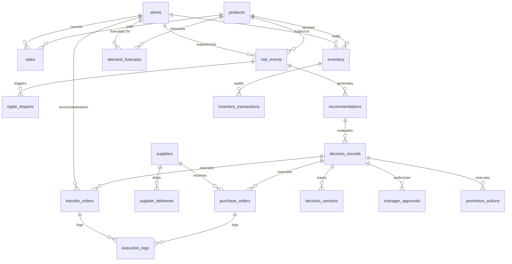
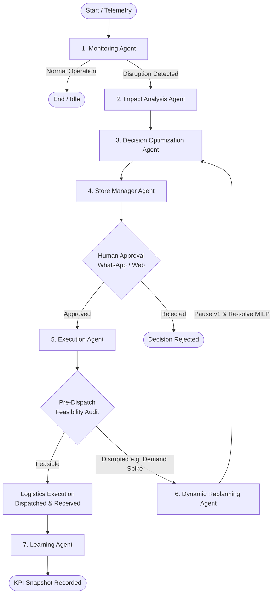

# RetailMind AI: Architectural Blueprint & System Design

## 1. Executive Summary

**RetailMind AI** is an explainable, adaptive, multi-agent retail decision intelligence platform designed to observe multi-store retail operations, predict granular demand distributions, detect supply-chain bottlenecks and ripple effects, evaluate multi-action interventions via mixed-integer linear programming (MILP), obtain human approvals via WhatsApp, simulate and execute logistics actions, and dynamically replan when operational conditions change.

The platform is built strictly as a modular backend and AI intelligence layer. Frontend integration occurs via documented FastAPI REST APIs and real-time WebSockets.

---

## 2. Technology Stack & Integration Architecture

| Component | Technology | Rationale & Configuration |
|---|---|---|
| **Backend Framework** | Python 3.10–3.13, FastAPI | High-concurrency async REST APIs, automatic OpenAPI 3.1 documentation, native WebSocket support |
| **Database** | PostgreSQL 16+ | ACID transactional guarantees, foreign key cascade integrity, row-level locking for inventory reservations |
| **ORM & Driver** | SQLAlchemy 2.0 Async, asyncpg | High-performance asynchronous query execution with greenlet |
| **Validation** | Pydantic v2 | Strict request/response typing, JSON serialization, environment configuration |
| **Machine Learning** | Scikit-learn (`HistGradientBoostingRegressor`) | Native quantile regression (`loss="quantile"`, $q \in \{0.10, 0.50, 0.90\}$) with categorical feature handling |
| **Explainability** | SHAP (`shap.Explainer`) | Feature contribution attributions and TreeExplainer SHAP weights |
| **Graph Intelligence** | NetworkX | Directed dependency graph (DAG) modeling retail cascades |
| **Mathematical Optimization**| Pyomo + HiGHS (`appsi_highs`) | Mixed-Integer Linear Programming (MILP) maximizing expected net profit across 6 business actions |
| **Simulation Engine** | SimPy + NumPy | Discrete-event What-If digital twin evaluating scenarios without mutating database state |
| **Agent Orchestration** | LangGraph, LangChain-Core | Typed state-machine multi-agent workflows with persistent checkpointing |
| **LLM Provider** | Groq Cloud API (`openai/gpt-oss-120b`) | Direct ultra-low-latency LLM synthesis without local model overhead or Ollama fallback |
| **Store Manager Interface**| Meta WhatsApp Cloud API + Mock Adapter | Real-time alerts, interactive button approvals, and natural-language inventory query resolution |
| **Background Processing** | Celery + Redis | Pre-dispatch feasibility auditing and periodic KPI performance snapshots |
| **Real-Time Gateway** | FastAPI WebSockets (`/ws/dashboard`) | Live event streaming (alerts, approvals, replanning, execution) to the React dashboard |
| **Testing** | Pytest, pytest-asyncio | End-to-end automated testing covering all 8 operational scenarios |

---

## 3. Database Schema Design (27 PostgreSQL Tables)

PostgreSQL serves as the single source of truth, enforcing inventory invariants and revision traceability.

### 3.1 Relational Schema Map

### 3.2 Inventory Ledger & Consistency Invariants

1. **Explicit Invariant**:
   $$\text{available\_stock} = \text{physical\_on\_hand} - \text{reserved\_stock}$$
2. **Valuation Rule**:
   $$\text{inventory\_valuation} = \text{available\_stock} \times \text{products.unit\_cost}$$
3. **Incoming Stock**: In-transit stock from POs or transfers is never added to `available_stock` until physical receipt confirmation (`/api/v1/executions/{id}/confirm-receipt`).
4. **Row-Level Locking**: Atomic stock reservations use `SELECT ... FOR UPDATE` to eliminate phantom stock and prevent double reservations.
5. **Auditable Movement Ledger**: Every stock change creates an immutable `inventory_transactions` record.

---

## 4. Multi-Agent Orchestration (LangGraph Architecture)

The system deploys 7 specialized agents connected via a centralized, typed state graph:

---

## 5. Dynamic Replanning State Machine

Dynamic Replanning continuously validates approved business decisions against live operational conditions prior to physical shipment dispatch.

### Concrete Demonstration Scenario:
1. **Decision v1**: AI recommends transferring 80 units of Milk from Coimbatore (`CBE_01`) to Salem (`SLM_01`).
2. **Approval**: Store manager approves via WhatsApp button. Decision status is set to `APPROVED`, stock status to `RESERVED` at Coimbatore.
3. **Disruption**: A local festival demand spike at Coimbatore raises expected local consumption by 45 units.
4. **Feasibility Breach**: Transferring 80 units would reduce Coimbatore's ending stock below its minimum safety stock buffer (15 units).
5. **Replanning Execution**:
   - `DynamicReplanningAgent` pauses the unexecuted transfer order and releases the reservation.
   - Transitions decision status to `REPLANNING` and increments version to `v2`.
   - Re-runs Pyomo MILP optimization to generate Version 2 alternatives:
     - *Alternative 1 (Split Transfer)*: Transfer 35 units from Coimbatore + 45 units from Trichy (`TRY_01`).
     - *Alternative 2 (Emergency PO)*: Order 80 units from Supplier 2 (`SUP_02`).
     - *Alternative 3 (Rationing)*: Transfer 35 units and adjust Salem allocation by 50%.
   - Groq synthesizes a revised WhatsApp prompt and sends it to the manager.
   - Enforces referential integrity: Approval for v1 cannot authorize v2; fresh approval is required.
